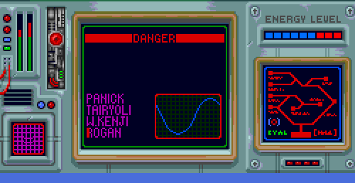
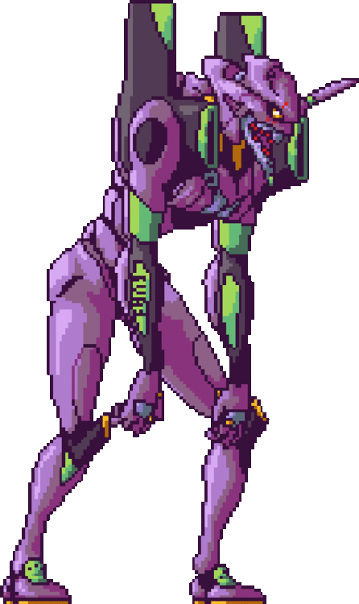
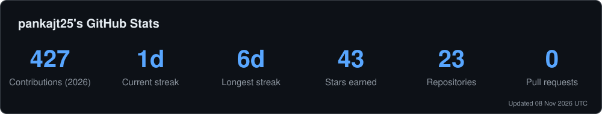
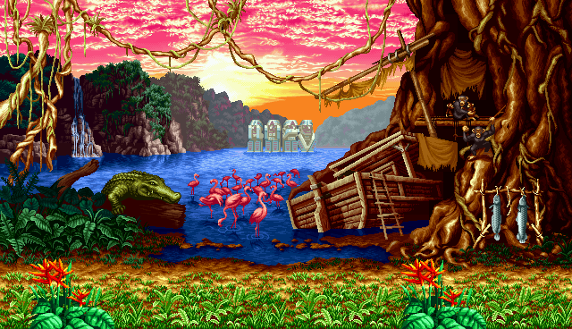

  

# About Me:

I'm Pankaj. I design, build and debug software, from APIs and databases to the interfaces people actually use.  
I built [WebGuard](https://github.com/pankajt25/WebGuard-scrapeverse), a price and stock tracker whose scraper repairs itself when a site changes its layout  
I built [Cerebro](https://github.com/pankajt25/Cerebro), a research agent that remembers what it learned across sessions using a knowledge graph  
I'm also working on a resume analyser that scores resumes against job descriptions  
I'm learning Linux administration and automation  
I'm looking for SDE internships and freelance web development work  
Ask me about React, Node.js, MongoDB and web dev

# 💻 Tech Stack:

 

# GitHub Stats

<table>
<tr>
<td width="50%" align="center"></td>
<td width="50%" align="center"></td>
</tr>
</table>

### Random Dev Quote

  

